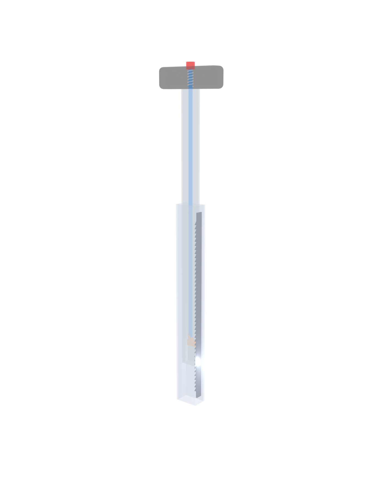

# Convoy

**Modular carry-on luggage that locks together to roll as one, with a ratcheting handle that holds at any height.**

<!-- Replace with your best render once you have one -->

## Why I built this

<!-- YOU WRITE THIS (3 to 5 sentences, your own words).
- What annoyed you about luggage at the airport?
- What made you think "I can fix that"?
- What is the one thing Convoy does that normal suitcases don't? -->

## Key specs

| Spec | Value |
|---|---|
| Size | 22 x 18 x 10 in (558.8 x 457.2 x 254 mm), standard US carry-on |
| Handle rods | 25 mm square aluminum, 26.5 mm bore |
| Handle travel | 172.5 mm |
| Handle lock | Ratchet, 6 mm tooth pitch (concept stage) |
| Coupler | In design |
| CAD | Autodesk Fusion |

## The two ideas

### 1. Ratchet handle
Normal suitcase handles only lock at 2 or 3 preset heights. Convoy's handle pushes down freely at any time and only extends when you hold the button on top.

<!-- Add the GIF of the handle extending here once you have it -->

Full write-up: [docs/03-handle-mechanism.md](docs/03-handle-mechanism.md)

### 2. Coupler
<!-- YOU WRITE THIS once you pick a design: how do two Convoy cases lock together? -->

Full write-up: [docs/05-coupler.md](docs/05-coupler.md)

## Design process

The full timeline, including what failed, is in the [build log](docs/build-log.md).

<!-- Pick 3 or 4 images from progress/ that show the design changing, one line each. -->

## Repo map

| Folder | What's inside |
|---|---|
| [`docs/`](docs/) | Design wiki: requirements, each subsystem, build log |
| [`parts/shell/`](parts/shell/) | Main shell CAD and exports |
| [`parts/handle/`](parts/handle/) | Telescoping ratchet handle |
| [`parts/wheels/`](parts/wheels/) | Wheels and mounts |
| [`parts/coupler/`](parts/coupler/) | Mechanism that links cases together |
| [`assembly/`](assembly/) | Full assembly and renders |
| [`progress/`](progress/) | Dated screenshots showing the design evolve |
| [`ai-assisted/`](ai-assisted/) | Anything made with AI help, clearly labeled |

## Status

- [x] Shell (v1)
- [x] Telescoping handle with slider joint
- [ ] Ratchet lock in Fusion
- [ ] Printed ratchet prototype and test
- [ ] Wheels
- [ ] Coupler

## Credits

Designed by <!-- your name -->.
Parts made with AI assistance live in [`ai-assisted/`](ai-assisted/), each with a note on who did what.

## License

<!-- e.g. CC BY 4.0 -->
