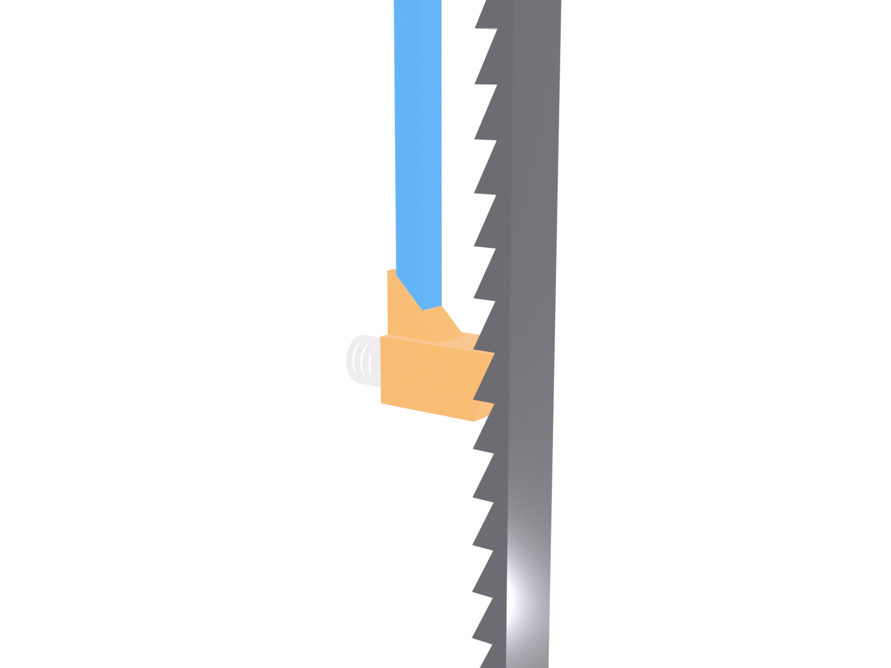
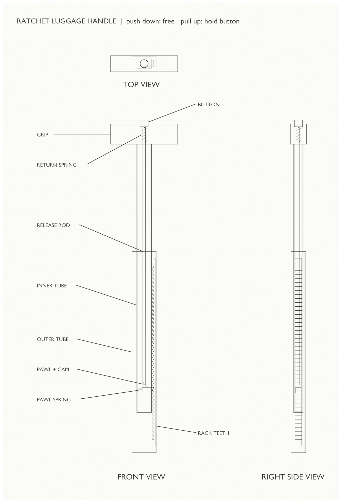

# Handle Mechanism

## The problem with normal handles
Standard telescoping handles use a spring-loaded pin that drops into holes in the outer tube, which gives only 2 or 3 heights.

## Convoy's ratchet
<!-- YOU WRITE in your own words. Cover:
- Sawtooth rack inside the outer tube (sloped face up, flat face down)
- Spring-loaded pawl in the inner tube
- Why pushing down skips over the teeth and pulling up locks
- How the button and release rod cam the pawl out of the teeth -->

## Key numbers
| Parameter | Value | Reason |
|---|---|---|
| Rod size | 25 mm square aluminum | |
| Travel | 172.5 mm | |
| Tooth pitch | 6 mm | Fine adjustment, teeth still strong |
| Pawl spring force | <!-- --> | |

## Open problem: downward load
Pushing a spinner case or leaning on the handle loads it downward, which is the direction the ratchet lets slide.
<!-- YOU WRITE: which fix you chose (stiff spring + steep ramp, two-stage button, or accept it) and why. -->

## Testing
<!-- Once you print a prototype: how many cycles, what force to collapse, what broke. Numbers + a photo/video. -->
